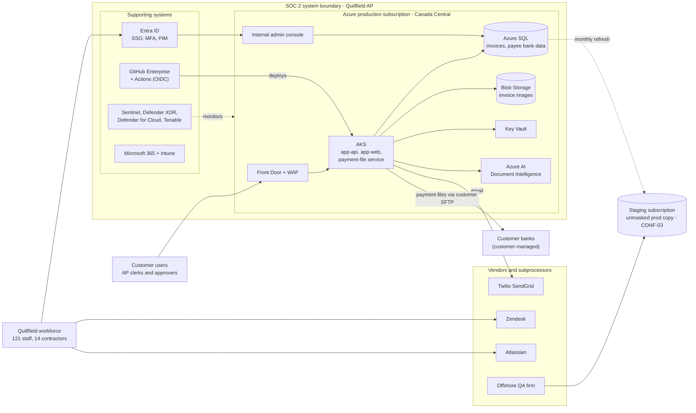

# SOC 2 Type I Readiness Assessment - Quillfield Systems Inc.

> [!IMPORTANT]
> **This is a simulated scenario built for learning and portfolio purposes.** Quillfield Systems Inc., its people, systems, numbers and evidence are fictional. No real company, client or audit is represented, and this is not a SOC 2 report or an attestation. It is a self-directed project showing how I would approach a SOC 2 readiness assessment.

**Criteria:** AICPA 2017 Trust Services Criteria (with revised points of focus, 2022) - Security (CC1-CC9) and Confidentiality (C1.1-C1.2)
**Mappings:** ISO/IEC 27001:2022 Annex A - NIST Cybersecurity Framework (CSF) 2.0
**Status as of:** October 16, 2026 (simulated) - **Target Type I as-of date:** March 31, 2027

## Contents

- [Scenario](#scenario)
- [Scope and system boundary](#scope-and-system-boundary)
- [Approach and methodology](#approach-and-methodology)
- [Key findings](#key-findings)
- [Readiness summary](#readiness-summary)
- [Remediation roadmap](#remediation-roadmap)
- [Skills demonstrated](#skills-demonstrated)
- [File index](#file-index)

## Scenario

**Quillfield Systems Inc.** is a fictional 121-employee B2B SaaS company headquartered in Toronto, with 14 contractors and an offshore QA firm. Its product, **Quillfield AP**, automates accounts payable for mid-market companies: invoice capture (OCR), approval workflows, supplier (payee) onboarding, and generation of payment files that customers send to their banks. Quillfield does not hold or move funds, but it stores customer invoices and supplier bank account details.

The platform runs on Microsoft Azure (Canada Central, with Canada East for recovery). The company uses Entra ID, Microsoft 365 E5, GitHub Enterprise Cloud, Microsoft Sentinel, Defender XDR, Defender for Cloud, Intune and Tenable, plus SaaS vendors such as Zendesk, Twilio SendGrid, Atlassian, BambooHR and NetSuite.

A large Canadian insurer in procurement with Quillfield requires a **SOC 2 Type I report** before signing, followed by a Type II within 12 months. Security is handled by a two-person team (Director, IT & Security and one Security Engineer) and nobody owns compliance. The CTO asked for a readiness assessment to find out what has to change before engaging a CPA firm. In the scenario, I play the GRC analyst doing that assessment.

## Scope and system boundary

| In scope | Out of scope |
| --- | --- |
| Quillfield AP production environment: Azure Front Door and WAF, AKS (app-api, app-web, payment-file service), Azure SQL, Blob Storage, Key Vault, Azure AI Document Intelligence, internal admin console | Availability, Processing Integrity and Privacy criteria |
| Supporting systems that control access to or changes in production: Entra ID, GitHub Enterprise Cloud and Actions, Sentinel, Defender XDR, Defender for Cloud, Intune, Tenable | Development subscription; corporate finance systems except as listed |
| Corporate systems that hold customer data: Microsoft 365 (SharePoint, OneDrive, Exchange), Zendesk, Jira and Confluence | Customers' own systems and bank connections (customer responsibility) |
| People and processes: HR (BambooHR as the trigger for access changes), vendor management (NetSuite vendor master as the control point) | Staging subscription, **provided** it stops holding production data. Today it holds unmasked copies, so it is assessed under CONF-03 and would be pulled into scope if that is not fixed |

**Subservice organizations (carve-out method):** Microsoft (Azure, physical data centre security) and GitHub. The SOC 2 report would describe the controls Quillfield expects them to operate, and Quillfield must monitor them (VND-03).

## Approach and methodology

The assessment followed the steps a readiness engagement would usually take, scaled to a solo project:

1. **Scope.** Defined the system boundary, the criteria (Security plus Confidentiality, chosen because the customer's security questionnaire focuses on protection of invoice and bank data) and the carve-outs.
2. **Control design.** Built a [control matrix](control-matrix.md) of 40 controls from the TSC criteria and points of focus, each with an owner, frequency and expected evidence. Mapped each to ISO/IEC 27001:2022 Annex A and NIST CSF 2.0 categories so the same controls can support future frameworks.
3. **Evidence dry run.** Issued a 43-item [evidence request list](evidence-request-list.md) as if from the auditor and recorded what came back.
4. **Testing (simulated).** Used inquiry, inspection of configuration and exports, and re-performance. Examples: reconciling the Entra ID user export to the HR roster; recalculating days from termination to account disable for every leaver; comparing merged pull requests to approvals; and querying Azure Activity logs for changes made outside the pipeline. Samples were judgmental, 25 items per test, to check whether each control works at all.
5. **Rating.** Each control was rated:
   - **Implemented:** designed appropriately, in place, with evidence as of the review date.
   - **Partial:** exists, but with incomplete coverage, no documentation, or exceptions in the sample.
   - **Missing:** no control, or no evidence that it operates.
6. **Risk.** Recorded 15 risks in a [risk register](risk-register.md) with likelihood x impact (1-5) scores for inherent, current residual and target residual, each linked to controls and gaps.
7. **Remediation.** Grouped the work into a 30/60/90-day roadmap that leaves time for one full quarterly cycle of recurring controls before the as-of date.

**ID conventions used in every file:** control IDs (`AC-05`), gap IDs (`G-03`), risk IDs (`R-01`) and evidence request IDs (`E-17`). For example, control AC-05 has gap G-03, is linked to risks R-01, R-03 and R-11, and is evidenced by E-17.

## Key findings

Overall readiness is **49%**: 9 controls implemented, 21 partial, 10 missing. Quillfield's technical foundation is better than its governance. The cloud architecture, encryption and deployment pipeline design are sound, and the security tools it needs are already licensed. The gaps are mostly about process, ownership and evidence.

**Top five gaps**

| # | Gap | Why it matters | Controls |
| --- | --- | --- | --- |
| 1 | **[G-07](gap-assessment.md#g-07-segregation-of-duties-is-not-defined-or-enforced) Segregation of duties.** 8 Tier 2 support users can change a customer's payee bank details in the admin console with no second approval (63 edits in Q3 2026, none reviewed). Deployments can be self-approved. | A single user, or a compromised account, could redirect a customer's supplier payments. | AC-07 |
| 2 | **[G-15](gap-assessment.md#g-15-customer-data-lifecycle-is-not-controlled) Customer data lifecycle.** Staging holds an unmasked monthly copy of production that the offshore QA firm can reach through a shared login; 4 former customers' data was never deleted despite a 90-day contractual commitment. | Live exposure of confidential data and a contract breach today; likely Confidentiality exceptions. | CONF-01 to CONF-04 |
| 3 | **[G-03](gap-assessment.md#g-03-no-user-access-reviews) / [G-04](gap-assessment.md#g-04-leavers-contractors-and-generic-accounts-remain-active) Access lifecycle.** No user access reviews in 2026. 21 enabled Entra accounts do not match an active person, including 2 leavers and 6 former contractors. | Orphaned accounts and missing reviews are among the most common SOC 2 exceptions. | AC-01, AC-04, AC-05 |
| 4 | **[G-06](gap-assessment.md#g-06-mfa-exclusions-and-standing-privileged-access) Privileged access and MFA.** PIM licensed but unused; 5 permanent Global Admins; 11 standing Owner/Contributor assignments on production; the CFO and 4 user-based service accounts are excluded from MFA. | Shortest path to a tenant-wide or production compromise. | AC-02, AC-06 |
| 5 | **[G-13](gap-assessment.md#g-13-changes-can-reach-production-without-review) Change management bypass.** The production Terraform repo has no branch protection (3 of 25 sampled PRs merged unreviewed); 41 production changes made in the portal in 30 days with no review. | CC8.1 is tested against the full change population; these would be exceptions. | CHG-01 to CHG-03 |

**Foundational gap:** [G-01](gap-assessment.md#g-01-governance-risk-assessment-and-monitoring-are-not-formalized) covers unapproved policies, no risk assessment, no leadership oversight and no control monitoring. Fixing it makes the other fixes stick. Vendor risk management ([G-14](gap-assessment.md#g-14-no-vendor-risk-management-process)) is also missing; this includes reviewing the Azure and GitHub SOC 2 reports that the carve-out depends on.

The [gap assessment](gap-assessment.md) covers all 15 gaps in criteria, condition, cause, effect and recommendation format.

## Readiness summary

Scoring: Implemented = 2, Partial = 1, Missing = 0, divided by the maximum. Heat: **Not ready** below 40%, **Partly ready** 40-69%, **Near ready** 70% and above.

| Domain | TSC | Controls | Implemented | Partial | Missing | Score | Heat |
| --- | --- | ---: | ---: | ---: | ---: | ---: | --- |
| Control environment and communication | CC1-CC2 | 7 | 4 | 2 | 1 | 71% | Near ready |
| Risk assessment and monitoring | CC3-CC5 | 4 | 0 | 2 | 2 | 25% | **Not ready** |
| Logical and physical access | CC6 | 12 | 4 | 6 | 2 | 58% | Partly ready |
| System operations | CC7 | 5 | 0 | 5 | 0 | 50% | Partly ready |
| Change management | CC8 | 4 | 1 | 3 | 0 | 62% | Partly ready |
| Risk mitigation and vendors | CC9 | 4 | 0 | 1 | 3 | 12% | **Not ready** |
| Confidentiality | C1 | 4 | 0 | 2 | 2 | 25% | **Not ready** |
| **Overall** | | **40** | **9** | **21** | **10** | **49%** | **Partly ready** |

**Risk profile (15 risks):** current residual is 3 Critical, 11 High and 1 Medium. If the roadmap is delivered, the target is 1 High, 13 Medium and 1 Low. The remaining High is R-06 (vulnerability exploitation), which leadership would need to accept explicitly. See the [risk register](risk-register.md#current-residual-heat-map).

**Overall view:** a Type I as of March 31, 2027 is achievable if the 30- and 60-day items are completed on time. The critical path is the recurring controls (quarterly access review, leadership review, control self-assessment), which each need at least one completed cycle before the as-of date.

## Remediation roadmap

Day 0 is Monday, October 26, 2026. Owners are roles; dates match the gap assessment and risk register.

### Days 0-30 (by November 25, 2026): stop the exposure

| Action | Controls | Gap | Owner |
| --- | --- | --- | --- |
| Stop production-to-staging refreshes, purge existing copies, replace shared staging SQL login | CONF-03 | G-15 | VP Engineering |
| Disable 2 leavers and 6 former contractors; assign an owner to or disable the 9 generic accounts | AC-01, AC-04 | G-04 | IT Administrator |
| Remove the CFO and user-based service accounts from MFA exclusions; add a break-glass sign-in alert | AC-02 | G-06 | Director, IT & Security |
| Apply the ruleset to `platform-infra`, remove admin bypass, enable "prevent self-review" | CHG-02, CHG-03, AC-07 | G-13, G-07 | DevOps Lead |
| Interim weekly review of payee bank-detail edits and restrict the permission to 3 named users | AC-07 | G-07 | Head of Customer Support |
| Disable "Anyone" sharing links and expire existing ones | CONF-04 | G-15 | IT Administrator |
| Onboard 7 macOS laptops to Defender for Endpoint | AC-12 | G-08 | IT Administrator |
| Submit the three core [policies](policies/) for approval; approve remediation SLAs | GOV-01, OPS-01 | G-01, G-09 | Director, IT & Security |

### Days 31-60 (by December 23, 2026): build the recurring controls

| Action | Controls | Gap | Owner |
| --- | --- | --- | --- |
| **First quarterly user access review (Q4 2026)** across all in-scope systems | AC-05 | G-03 | Director, IT & Security |
| Roll out PIM for Entra and production Azure roles; cut Global Admins to 4; rotate and own app secrets | AC-06 | G-06 | Director, IT & Security |
| First quarterly leadership security review; risk workshop and acceptance of the risk register | GOV-03, RISK-01 | G-01 | CTO |
| Approve IR plan with PIPEDA breach steps; tabletop exercise; retrospective review of the May 2026 incident | OPS-04 | G-11 | Director, IT & Security |
| Make the JSM form the only access request path; add contractors to BambooHR; enable automated deprovisioning | AC-03, AC-04 | G-05, G-04 | IT Administrator |
| Enrol contractors in training; manager escalation for overdue training | HR-02 | G-02 | Security Engineer |
| Jira-key status check on PRs; emergency change label and retrospective approval | CHG-01 | G-13 | VP Engineering |
| Set PITR to 35 days with monthly LTR; enable Blob versioning; first restore test | OPS-05 | G-12 | DevOps Lead |
| Tier vendors; request SOC 2 reports from Tier 1 vendors and subservice organizations | VND-01, VND-03 | G-14 | Controller; Director, IT & Security |

### Days 61-90 (by January 22, 2027): close remaining gaps

| Action | Controls | Gap | Owner |
| --- | --- | --- | --- |
| Ship dual approval for payee bank-detail edits; write the SoD matrix | AC-07 | G-07 | VP Engineering |
| Deletion runbook; delete the 4 former customers' data and send confirmations | CONF-02 | G-15 | VP Engineering |
| Masked or synthetic staging data set | CONF-03 | G-15 | VP Engineering |
| SOC report review memos with CUEC mapping; Atlassian DPA filed; QA firm contract amended; security tier required in NetSuite | VND-02, VND-03 | G-14 | Director, IT & Security; Controller |
| BC/DR runbook with RTO/RPO and one DR test | BCP-01 | G-12 | CTO |
| Connect GitHub, AKS and Key Vault logs; 12-month retention; triage SLA and closure notes | OPS-02, OPS-03 | G-10 | Security Engineer |
| Clear criticals older than 30 days; fix and retest the open pen test finding | OPS-01, MON-02 | G-09 | Security Engineer |
| Publish sensitivity labels; DLP to enforce mode; approve classification standard | CONF-01, CONF-04 | G-15 | Director, IT & Security |
| SaaS register and data store tagging; contractor device controls | RISK-02, AC-12 | G-08 | IT Administrator |
| First quarterly control self-assessment against the matrix | MON-01 | G-01 | Director, IT & Security |

### After 90 days

- **February 2027:** readiness re-check against this matrix; re-score the risk register; draft the system description; confirm the CPA firm and fieldwork dates.
- **Q1 2027 (by March 31):** second quarterly access review and leadership review, so each recurring control has run at least once (ideally twice) by the as-of date.
- **March 31, 2027:** Type I as-of date. Controls then operate through the Type II observation period, which would typically start right after.

## Skills demonstrated

- Scoping a SOC 2 engagement: system boundary, criteria selection and the carve-out of subservice organizations
- Designing a control matrix with owners, frequencies and evidence, mapped across the TSC, ISO/IEC 27001:2022 and NIST CSF 2.0
- Testing access controls the way an auditor would: population completeness, leaver timing, user access review design, segregation of duties
- Change management testing against a full change population, including detecting changes made outside the pipeline
- Vendor risk management tied to an existing finance control point (the vendor master)
- Risk scoring and turning findings into a dated, owned remediation plan
- Writing policies that someone can actually follow and audit against

This project draws on my background in financial audit and SOX controls (user access reviews and SoD in SAP and Concur, change management, evidence gathering, vendor master data controls) and my cyber range work with Azure, Entra ID, Sentinel, Defender XDR and Tenable.

## File index

| File | What it is |
| --- | --- |
| [README.md](README.md) | This overview: scenario, scope, method, findings, readiness score and roadmap |
| [control-matrix.md](control-matrix.md) | 40-control SOC 2 matrix grouped by domain, readable on GitHub |
| [control-matrix.csv](control-matrix.csv) | Same matrix as CSV (GitHub renders it as a searchable table) |
| [control-matrix.xlsx](control-matrix.xlsx) | Same matrix as a workbook with filters, state drop-downs and a formula-driven summary sheet |
| [gap-assessment.md](gap-assessment.md) | 15 gaps by domain with criteria, condition, simulated evidence, cause, effect and recommendation |
| [risk-register.md](risk-register.md) | 15 risks with inherent, current and target scores, treatment, owner and date, plus heat map |
| [risk-register.xlsx](risk-register.xlsx) | Same register with live L x I formulas, rating bands and a heat map sheet |
| [evidence-request-list.md](evidence-request-list.md) | 43-item PBC list mapped to controls, with dry-run results |
| [policies/access-control-policy.md](policies/access-control-policy.md) | Access Control Policy, including quarterly user access reviews and SoD |
| [policies/change-management-policy.md](policies/change-management-policy.md) | Change Management Policy |
| [policies/vendor-risk-management-policy.md](policies/vendor-risk-management-policy.md) | Vendor Risk Management Policy |

## Limitations

- Everything here is simulated. Real evidence would come with messier exports, competing priorities and controls that look fine on paper but fail on testing.
- A readiness assessment is not an audit opinion. The CPA firm decides on the system description, scope and whether controls are suitably designed.
- Framework mappings are my own and cite ISO/IEC 27001:2022 Annex A at control level and NIST CSF 2.0 at category level. They would be checked against the official AICPA mapping spreadsheets before being used for anything real.
